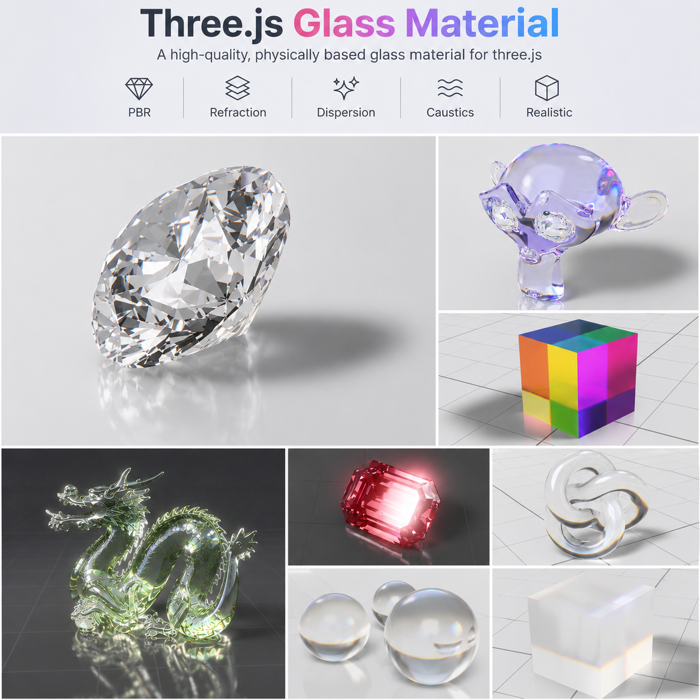

<p align="center">
  
</p>

Real-time physical glass rendering in the browser with **Three.js** and **TSL** (compiles to **WebGPU / WGSL**, with automatic fallback to **WebGL 2 / GLSL**): exact dielectric Fresnel, continuous CIE 1931 spectral dispersion, Beer–Lambert volumetric absorption, HDRI environments (`envMap`), frosted glass (毛玻璃), 6 diamond cuts, CMY dichroic cubes, photon-traced caustics, and instanced rendering of thousands of glass objects.

---

## Features

- **Standalone [`MeshGlassMaterial`](src/glass/material.ts)** (`extends THREE.MeshBasicNodeMaterial`) — 100% geometry-agnostic physical glass matching `MeshPhysicalMaterial` ergonomics (`ior`, `dispersion`, `roughness`, `thickness`, `transmission`, `envMap`, `envMapIntensity`, `clone()`).
- **Standalone [`DiamondMesh`](src/glass/diamondMesh.ts)** (`extends THREE.Mesh`) — self-contained multi-bounce ray-traced diamond across all 6 cuts (`round`, `princess`, `emerald`, `asscher`, `cushion`, `radiant`) with automatic geometry + facet-shader switching and `restOnFloor()`.
- **Physical Details** — bevelled edges on faceted shapes (the thin facets that catch the light along cut glass), caustics traced per wavelength band so dispersion colours them, glass reflecting neighbouring glass, contact shadows as weak as the glass is clear, and optional faint surface imperfections.
- **Exact Optical Math** — unpolarized Cook–Torrance dielectric Fresnel, continuous CIE 1931 spectral dispersion (Fraunhofer C/d/F Cauchy curve; 6–24 jittered wavelengths per pixel, more the stronger the dispersion), Beer–Lambert volumetric absorption, ray-cone analytic filtering, and Total Internal Reflection (TIR).
- **HDRI Environments & Firefly-Free Bloom** — equirectangular HDRI `envMap` support with roughness-driven mipmap LOD (with automatic procedural studio fallback), 4K/2K Poly Haven CC0 HDRI presets in the interactive `lil-gui` demo, and a quarter-res 4×4 prefiltered bloom pass with a hue-preserving soft firefly shoulder.
- **Frosted Glass (毛玻璃)** — noise-free analytic environment softening, 3-octave organic micro-particle grain (`frostScale`), creamy translucent frost veil, and crisp Fresnel rim.
- **Instanced Studio Renderer** — [`createInstancedGlass`](src/glass/renderer.ts) for rendering up to 20,000 glass objects (including 8-tap tricubic SDF meshes for Suzanne, the Stanford Dragon, and an exactly baked torus knot) with glass-through-glass depth layering, real photon-traced caustics, floor reflections, half-res bilateral contact shadows, CMY dichroic face filters, depth of field, bloom, and temporal anti-aliasing (Halton sub-pixel jitter, depth reprojection with neighbourhood clipping while moving, and an exact running average that settles a still view in a few frames).

---

## Quick Start

### 1. Frosted / Colored Glass on Any Three.js Mesh

```ts
import * as THREE from 'three/webgpu';
import { MeshGlassMaterial } from './src/glass';

const scene = new THREE.Scene();
const camera = new THREE.PerspectiveCamera(45, window.innerWidth / window.innerHeight, 0.1, 100);
camera.position.set(0, 1.5, 4);

const renderer = new THREE.WebGPURenderer({ antialias: true });
renderer.setSize(window.innerWidth, window.innerHeight);
document.body.appendChild(renderer.domElement);

const glass = new MeshGlassMaterial({
  ior: 1.52, // Optical crown glass
  dispersion: 0.6, // Chromatic dispersion
  roughness: 0.25, // Frosted glass (0 = clear, 1 = fully frosted)
  frostScale: 5, // Higher = finer sandblasted micro-particles
  color: '#b8e0ff', // Beer-Lambert volumetric tint
  thickness: 1.2, // Approximate thickness in world units
  transmission: 1, // Automatically refract opaque meshes behind the glass
});

const knot = new THREE.Mesh(new THREE.TorusKnotGeometry(0.8, 0.28, 180, 36), glass);
scene.add(knot);

await renderer.init();
renderer.setAnimationLoop(() => {
  knot.rotation.y += 0.008;
  renderer.render(scene, camera);
});
```

### 2. Exact Multi-Bounce `DiamondMesh` with Cut Switching

```ts
import { DiamondMesh } from './src/glass';

const diamond = new DiamondMesh({
  cut: 'princess',
  ior: 2.42, // Real diamond IOR
  dispersion: 0.4, // Spectral fire
  bounces: 6, // Internal reflections
  envMap: hdr, // Optional equirectangular HDRI
});
diamond.restOnFloor(); // Tilts flush onto a pavilion facet at y = 0
scene.add(diamond);

// Switch cuts dynamically at runtime (updates geometry + facet shader atomically):
diamond.cut = 'emerald';
diamond.restOnFloor();
```

### 3. Live Reactive Updates (Zero Shader Recompilation)

Every optical property is backed by a GPU uniform—mutating properties updates the shader immediately:

```ts
glass.ior = 1.66; // Lead crystal
glass.dispersion = 1.2; // Stronger prismatic fire
glass.roughness = 0.4; // Frosted glass
glass.frostScale = 8; // Ultra-fine micro-particles
glass.color.set('#ff88aa'); // Rose quartz tint
glass.envMapIntensity = 1.2; // Scale HDRI brightness
```

### 4. Equirectangular HDRI Environments (`envMap`) & Cloning

Load any equirectangular `.hdr` / `.exr` environment map and bind it directly to `MeshGlassMaterial` (mipmaps are sampled automatically by `roughness`, falling back to a neutral studio when `null`):

```ts
import * as THREE from 'three/webgpu';
import { HDRLoader } from 'three/addons/loaders/HDRLoader.js';

const hdr = await new HDRLoader().loadAsync(
  'https://dl.polyhaven.org/file/ph-assets/HDRIs/hdr/4k/santos_beach_pavillion_4k.hdr',
);
hdr.mapping = THREE.EquirectangularReflectionMapping;
hdr.wrapS = THREE.RepeatWrapping;
hdr.wrapT = THREE.ClampToEdgeWrapping;
hdr.minFilter = THREE.LinearMipmapLinearFilter;
hdr.magFilter = THREE.LinearFilter;
hdr.generateMipmaps = true;
hdr.needsUpdate = true;

glass.envMap = hdr;
glass.envMapIntensity = 1.0;

// Create an independent clone sharing the same HDRI with a different tint:
const amberGlass = glass.clone();
amberGlass.color.set('#ffaa44');
```

### 5. CMY Dichroic Cube with `MeshGlassMaterial`

Because `MeshGlassMaterial` is geometry-agnostic and supports `.clone()`, you can build a standalone CMY cube by pairing Three.js's 6-face `BoxGeometry` with Cyan, Yellow, and Magenta clones of a base `MeshGlassMaterial`:

```ts
import * as THREE from 'three/webgpu';
import { MeshGlassMaterial } from './src/glass';

const base = new MeshGlassMaterial({
  ior: 1.49, // Optical acrylic
  dispersion: 0.35,
  thickness: 1.0,
  transmission: 1,
  envMap: hdr,
});

const cyan = base.clone();
cyan.color.set('#00e5ff');
const yellow = base.clone();
yellow.color.set('#ffe600');
const magenta = base.clone();
magenta.color.set('#ff00aa');

// BoxGeometry face order: [+X, -X, +Y, -Y, +Z, -Z]
const cmyCube = new THREE.Mesh(new THREE.BoxGeometry(1, 1, 1), [cyan, cyan, yellow, yellow, magenta, magenta]);
scene.add(cmyCube);
```

For exact multi-bounce subtractive dichroic filtering and colored floor caustics, use `KIND.box` with `cmy` / `cmyOrder` in [`createInstancedGlass`](#9-high-scale-studio-caustics-renderer-createinstancedglass):

```ts
instanced.render(glass, { ...lighting, cmy: 1, cmyOrder: 'cym', bevel: 0.02 }, false);
```

### 6. Any Mesh as Solid Glass (`bakeGlassVolumeAsync`)

Bake any `BufferGeometry` into a signed-distance volume in a Web Worker, and `MeshGlassMaterial` follows the light through it exactly on every internal bounce. Real-world meshes are rarely clean solids, so the bake makes them solid first: it welds duplicate vertices, splits the mesh into pieces, caps every hole, and merges the pieces (optionally Loop-subdivided, optionally with a fillet where they meet):

```ts
import { TeapotGeometry } from 'three/addons/geometries/TeapotGeometry.js';
import { MeshGlassMaterial, bakeGlassVolumeAsync } from './src/glass';

const geometry = new TeapotGeometry(1, 10); // open, unwelded patches; separate lid, spout, handle
const volume = await bakeGlassVolumeAsync(geometry); // ~4 s in a worker
scene.add(new THREE.Mesh(geometry, new MeshGlassMaterial({ ior: 1.52, dispersion: 1, transmission: 1, volume })));
```

`bakeGlassVolume(positions, indices, options)` (`src/glass/bake.ts`) is the same pipeline as a plain function, dependency-free, for build scripts in Node (`scripts/bake-suzanne-sdf.ts` uses it).

### 7. With three.js TRAA (`temporal`)

`MeshGlassMaterial` pairs with three.js's temporal anti-aliasing: with `temporal: true` the wavelengths move every frame, so TRAA averages them into smooth, continuous dispersion (and anti-aliases edges):

```ts
import { traa } from 'three/addons/tsl/display/TRAANode.js';
import { mrt, output, pass, velocity } from 'three/tsl';

const glass = new MeshGlassMaterial({ ior: 1.52, dispersion: 1, transmission: 1, temporal: true });
const renderer = new THREE.WebGPURenderer({ antialias: false }); // TRAA needs MSAA off
const pipeline = new THREE.RenderPipeline(renderer);
const scenePass = pass(scene, camera);
scenePass.setMRT(mrt({ output, velocity }));
pipeline.outputNode = traa(
  scenePass.getTextureNode('output'),
  scenePass.getTextureNode('depth'),
  scenePass.getTextureNode('velocity'),
  camera,
);
renderer.setAnimationLoop(() => pipeline.render());
```

### 8. Standard Three.js `InstancedMesh` (with Per-Instance Colors)

`MeshGlassMaterial` works natively with `THREE.InstancedMesh` and `THREE.BatchedMesh`. Per-instance colors from `setColorAt()` are routed directly into Beer–Lambert volumetric absorption so outer Fresnel highlights stay crisp white:

```ts
const glass = new MeshGlassMaterial({ ior: 1.52, dispersion: 0.6, transmission: 1, envMap: hdr });
const spheres = new THREE.InstancedMesh(new THREE.SphereGeometry(0.4, 32, 32), glass, 100);
spheres.setColorAt(0, new THREE.Color('#ff6688'));
spheres.setColorAt(1, new THREE.Color('#66ccff'));
scene.add(spheres);
```

### 9. High-Scale Studio Caustics Renderer (`createInstancedGlass`)

For scenes with hundreds or thousands of glass objects, real caustics, floor reflections, and contact shadows, pass a `MeshGlassMaterial` directly to `instanced.render()`:

```ts
import { MeshGlassMaterial, KIND, createGlassObjects, createInstancedGlass } from './src/glass';

const objects = createGlassObjects();
objects.count = 1;
objects.kind[0] = KIND.sphere;
objects.center.set([0, 0.6, 0], 0);
objects.quat.set([0, 0, 0, 1], 0);
objects.size.set([0.6, 0.6, 0.6], 0);

const glass = new MeshGlassMaterial({ ior: 1.52, dispersion: 1, roughness: 0.15 });
const instanced = createInstancedGlass(renderer, camera, objects, meshes);

instanced.render(glass, lighting, false);
```

---

## API Reference

### `new MeshGlassMaterial(params?: MeshGlassMaterialParameters)`

Extends `THREE.MeshBasicNodeMaterial`.

#### Constructor Parameters & Live Properties

| Property          | Type                            | Default    | Description                                                                                                                                                                                                             |
| :---------------- | :------------------------------ | :--------- | :---------------------------------------------------------------------------------------------------------------------------------------------------------------------------------------------------------------------- |
| `ior`             | `number`                        | `1.52`     | Index of refraction (`1.0` – `2.5`). Examples: `1.47` borosilicate, `1.49` acrylic, `1.52` crown glass, `1.62` flint glass, `2.42` diamond.                                                                             |
| `dispersion`      | `number`                        | `0.5`      | Chromatic dispersion strength (`0` disables RGB splitting; `0.4` realistic diamond fire; `1.0+` vivid prism fire).                                                                                                      |
| `roughness`       | `number`                        | `0`        | Frosted glass amount (`0` = crystal clear, `1` = fully frosted 毛玻璃).                                                                                                                                                 |
| `frostScale`      | `number`                        | `4`        | Frosted grain density (`0.5` = coarse etched frost, `4`–`12` = fine sandblasted micro-particles).                                                                                                                       |
| `color`           | `THREE.ColorRepresentation`     | `0xffffff` | Volumetric glass tint color (Beer–Lambert transmittance across `thickness`).                                                                                                                                            |
| `thickness`       | `number`                        | `1`        | Characteristic thickness in world units used for refraction & Beer–Lambert absorption.                                                                                                                                  |
| `transmission`    | `number`                        | `0`        | Automatic scene refraction (`0`–`1`), matching `MeshPhysicalMaterial` via Three.js `viewportOpaqueMipTexture` with roughness mipmaps.                                                                                   |
| `envMap`          | `THREE.Texture \| null`         | `null`     | Optional equirectangular HDRI / environment texture (overrides the neutral fallback studio; mip-blurred automatically by `roughness`).                                                                                  |
| `envMapIntensity` | `number`                        | `1`        | Intensity multiplier applied to `envMap`.                                                                                                                                                                               |
| `backfaceMap`     | `THREE.Texture \| null`         | `null`     | Optional back-face normal & depth map from `GlassBackfacePass` for exact exit refraction & thickness on arbitrary concave meshes.                                                                                       |
| `volume`          | `GlassVolume \| 'auto' \| null` | `'auto'`   | Baked 128³ signed-distance volume (exact exits for every bounce). `'auto'` bakes one per geometry in a worker when there is no exact formula and no `backfaceMap` (the estimate until it is ready); `null` never bakes. |
| `bounces`         | `number`                        | `6`        | Internal events followed per ray (`4` by default with a `volume`).                                                                                                                                                      |
| `imperfections`   | `number`                        | `0`        | Faint surface waviness (`0` perfect glass, `1` clearly hand-made).                                                                                                                                                      |
| `exactShapes`     | `boolean`                       | `true`     | Trace three.js built-in solids (sphere, box, cylinder, cone, capsule, torus, octahedron) exactly from their geometry parameters, on `Mesh` and `InstancedMesh`.                                                         |
| `temporal`        | `boolean`                       | `false`    | For renders that average frames (three.js TRAA): the wavelengths move every frame, so the average is a continuous spectrum. Off: fixed, evenly spaced wavelengths.                                                      |
| `spectralSamples` | `number`                        | `0`        | Wavelengths per pixel and frame (`0`: as many as the dispersion needs).                                                                                                                                                 |

#### Methods

- **`clone(): MeshGlassMaterial`**
  Creates an independent clone with identical optical parameters and texture bindings.

---

### Exits: how `MeshGlassMaterial` follows light inside any mesh

`MeshGlassMaterial` shades with the same tracer as the instanced renderer (`src/glass/tsl/trace.ts`): every internal event with exact Fresnel and total internal reflection, continuous spectral dispersion and Beer–Lambert absorption. Where a ray leaves the glass comes from the best source available:

1. **`volume`** — a baked signed-distance volume: exact exits for every bounce. By default (`'auto'`) every geometry without an exact formula gets one, baked once in a worker; or pass your own from `bakeGlassVolumeAsync`.
1. **Built-in solids** — `SphereGeometry`, `BoxGeometry`, `CylinderGeometry`, `ConeGeometry`, `CapsuleGeometry`, `TorusGeometry` and `OctahedronGeometry` are traced exactly from their parameters, with no setup (`exactShapes`, on by default).
1. **`backfaceMap`** — the `GlassBackfacePass` map: the exact first exit along the view ray, then estimates.
1. **`thickness`** only — a smooth local-sphere estimate.

See `mesh.html` (`npm run dev`, then open `/mesh.html`) for all three on plain meshes.

### `new GlassBackfacePass(options?: { resolutionScale?: number })`

Optional offscreen `THREE.BackSide` pre-pass for arbitrary concave meshes (Suzanne, Stanford Dragon, custom GLTFs) without offline SDF baking:

```ts
const backfacePass = new GlassBackfacePass({ resolutionScale: 0.5 });
glass.backfaceMap = backfacePass.texture;

// Before renderer.render(scene, camera):
backfacePass.render(renderer, scene, camera);
renderer.render(scene, camera);
```

---

### `new DiamondMesh(params?: DiamondMeshParameters)`

Extends `THREE.Mesh`. Owns both the watertight convex facet `BufferGeometry` (`diamondGeometry(cut)`) and exact multi-bounce internal facet-plane raytracing.

- **Properties**: `cut` (`DiamondCut`), `ior` (default `2.42`), `dispersion` (default `0.4`), `bounces` (default `6`), `roughness`, `frostScale`, `color`, `transmission`, `envMap`, `envMapIntensity`, `restHeight`, `restLean`.
- **Methods**: `restOnFloor(y?: number): this`, `dispose(): void`.

---

### Types & Helpers

#### `DiamondCut`

```ts
type DiamondCut = 'round' | 'princess' | 'emerald' | 'asscher' | 'cushion' | 'radiant';
```

#### `diamondGeometry(cut?: DiamondCut): THREE.BufferGeometry`

Builds a watertight, flat-shaded `BufferGeometry` of size 1 for the given diamond cut directly from its convex facet planes.

#### `DIAMOND_CUTS: Record<DiamondCut, DiamondCutSpec>`

Metadata for each cut: `{ label, planes, planeCount, rest, lean }`, where `rest` is the resting center height above `y = 0` and `lean` is the tilt angle (radians around Z) to sit flat on a pavilion facet.

---

## Development & Testing

```bash
npm install          # Install dependencies
npm run dev          # Start Vite dev server (open ?shape=diamond or ?shape=torus-knot&count=27&layout=grid)
npm test             # Run Vitest unit test suite
npm run test:screenshots         # Playwright screenshot tests (shapes, camera angles, glass settings, mesh page)
npm run test:screenshots:update  # Regenerate the screenshot baselines after an intended visual change
npm run lint         # Run oxlint static analysis
npm run format       # Format codebase with Prettier
npm run format:check # Verify Prettier formatting
npm run typecheck    # TypeScript check (tsc --noEmit)
npm run build        # Production build
npm run deploy       # Build and deploy demo to GitHub Pages
node scripts/bake-torusknot-sdf.ts  # Re-bake public/torusknot_sdf_128.bin after changing src/glass/torusKnot.ts
node scripts/bake-suzanne-sdf.ts    # Re-bake public/suzanne_sdf_128.bin (subdivided, eyes merged into a solid head)
```

---

See [ROADMAP.md](ROADMAP.md) for what is planned next.

## Credits

- **HDRI environments:** CC0 4K/2K equirectangular HDRIs streamed from [Poly Haven](https://polyhaven.com/hdris) (Santos Beach Pavilion, Kloofendal Sky, Venice Sunset, Belfast Sunset, Photo Studio, Rogland Clear Night).
- **Dragon model:** the Stanford dragon, © 1996 Stanford University Computer Graphics Laboratory ([Stanford 3D Scanning Repository](https://graphics.stanford.edu/data/3Dscanrep/)), converted and cleaned up by Morgan McGuire (© 2017), from the [Khronos glTF sample models](https://github.com/KhronosGroup/glTF-Sample-Assets/tree/main/Models/DragonAttenuation). Free for non-commercial use with credit to the Stanford Computer Graphics Laboratory; not to be used in a product for sale without their permission.
- **Suzanne:** Blender’s test mesh.
